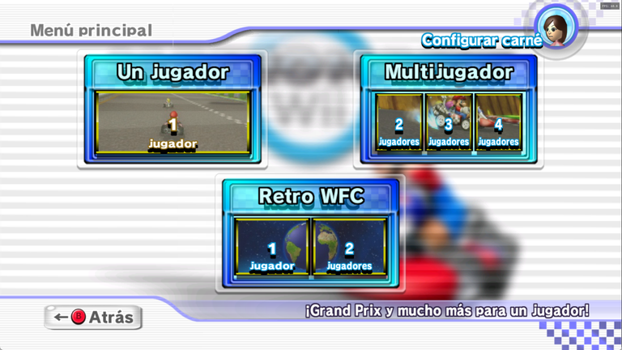
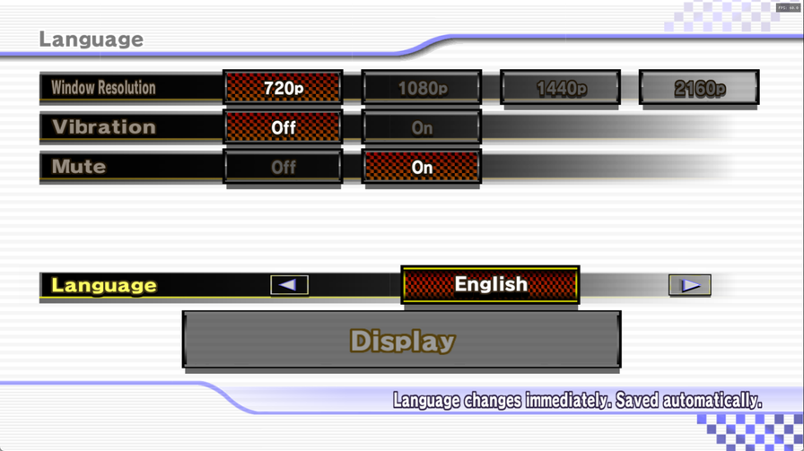
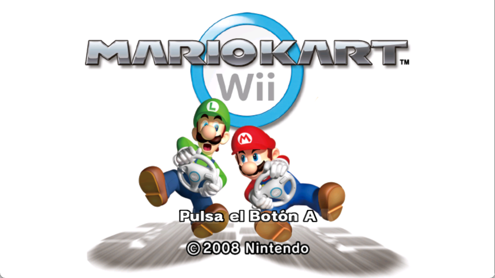

<div align="center">


[](https://github.com/MarcPique/mario-kart-wii-pc-builder/releases/latest)


[](#online-habilitado)
[](LICENSE)

### Tu disco de Mario Kart Wii. Tu juego de Windows.

**Selecciona tu imagen PAL → compila en tu PC → abre Mario Kart Wii.exe desde el escritorio.**

**[⬇ Descargar el instalador para Windows](https://github.com/MarcPique/mario-kart-wii-pc-builder/releases/latest/download/MKWii-PC-Builder.exe)** · [Capturas](#capturas) · [Instalación](#instalación) · [Cambios](CHANGELOG.md)

</div>

Este builder genera una instalación nativa para Windows a partir de **tu propio disco PAL RMCP01**, con opciones de PC integradas en los menús del juego. El instalador público **no contiene la ROM, el juego recompilado, partidas ni claves de consola**.

**✅ Online habilitado mediante Retro WFC:** login, amigos y salas integrados en el propio juego, sin cerrar ni cambiar de ejecutable. Las salas se consultan al iniciar y se actualizan automáticamente cada **40 segundos**.

**🌍 [Probar 1.1.0-preview.2: 15 idiomas](https://github.com/MarcPique/mario-kart-wii-pc-builder/releases/tag/v1.1.0-preview.2)** · Español, English, Français, Deutsch, Italiano, Nederlands, Čeština, Suomi, Русский, Türkçe, Español LA, Català, Galego, Euskara y Andalûh. Usa solo las fuentes existentes y cambia sin reiniciar. **Catalán, gallego y euskera tienen traducción automática experimental**, marcada en el menú; otros idiomas añadidos incluyen suplementos automáticos. Andaluh es una transcripción EPA. Las voces e imágenes no se traducen. [Procedencia, límites y generación](docs/LOCALIZATION.md). La descarga estable superior sigue siendo 1.0.2, con cinco idiomas.

## Lo que incluye

| 🏁 El juego | ⚙️ Opciones de PC | 🌍 Idiomas y online |
|---|---|---|
| Ventana **Mario Kart Wii** | **Opciones avanzadas** en Opciones y pausa | Español, English, Français, Deutsch e Italiano |
| Icono en EXE, ventana y barra de tareas | Presets, resolución, formato, V-Sync, AA y anisotropía | **Idioma inmediato**, sin reiniciar |
| Presentación original y preparación oculta | Controles, fuentes y animaciones nativos | **Online habilitado: Retro WFC** en la misma sesión |
| EXE de arranque en el escritorio | Sin barra flotante ni necesidad de F10 | Salas al abrir y cada **40 segundos** |

El icono completo se obtiene **localmente del banner de tu disco**. La integración usa Retro Rewind **6.13.4**, incluido su contenido adicional y sus cambios de jugabilidad.

### Mandos, personajes y salas

La versión **1.0.2** incluye la página nativa **Mandos** y asignación a cuatro jugadores locales. Al abrir el juego o cambiar los dispositivos conectados, los mandos ocupan automáticamente **J1, J2, J3 y J4**, antes que el teclado. Se conserva su orden relativo y se rellenan los puestos libres; después puedes reasignarlos manualmente en Ajustes. El teclado controla J1 cuando no hay mando. El selector muestra la familia (**DualSense, DualShock, Switch Pro, Xbox**) y el panel inferior muestra el **nombre completo** del modelo; al recorrer las filas de jugadores también aparece su asignación completa. Se ha probado un **DualSense Edge por Bluetooth** y la conexión/desconexión de mandos virtuales. Otros modelos y cuatro mandos físicos simultáneos requieren pruebas en esos dispositivos.

Los **personajes personalizados incluidos en Retro Rewind también se usan en las carreras locales**: selecciona un personaje y pulsa **L/R** para elegir su variante antes de confirmar. En DualSense son **L1/R1** con la configuración predeterminada. Se ha verificado **Mario (Fire) en Grand Prix**, además del modelo de selección. Esto no añade modelos externos que no formen parte del pack instalado.

También incluye la consulta de versiones de Retro Rewind, «Todas las pistas» en ajustes recién creados y el selector de salas públicas. Se ha verificado la entrada a salas Retro y CT; otros modos y cambios de anfitrión necesitan más pruebas. **Hasta cuatro jugadores en multijugador local; hasta dos jugadores locales por PC en Retro WFC.** Cuatro jugadores online desde una sola conexión requerirían ampliar los paquetes del juego y la compatibilidad de los demás clientes; esta versión no lo implementa.

### Pantallas, texturas y salida · preview 2

La [versión 1.1.0-preview.2](https://github.com/MarcPique/mario-kart-wii-pc-builder/releases/tag/v1.1.0-preview.2) añade **Salir al escritorio** al menú principal con confirmación nativa y **Cancelar** como opción inicial. B cancela; confirmar Salir cierra el juego.

**16 formatos:** Automático, 4:3, 5:4, 3:2, 16:10, 16:9, 1.85:1, 2:1, 21:9, 43:18, 64:27, 32:10, 32:9, 48:9, 1:1 y 9:16. En **Opciones avanzadas → Formato**, Automático sigue la ventana; un formato fijo conserva las proporciones con bandas cuando corresponde. El campo de visión se adapta mediante el sistema EGG existente.

**Paquetes de texturas de Dolphin:** PNG/DDS descomprimidos en `UserData/Load/Textures/RMCP01` o `RMC`. Activa, desactiva y recarga desde **Opciones avanzadas → Paquetes de texturas**, sin reiniciar. Las texturas ausentes o no válidas conservan las originales. No se incluyen paquetes ni se sobrescriben los archivos del disco. [Formato de carpetas y límites](docs/TEXTURE-PACKS.md).

## Instalación

1. Descarga **[MKWii-PC-Builder.exe](https://github.com/MarcPique/mario-kart-wii-pc-builder/releases/latest/download/MKWii-PC-Builder.exe)** desde Releases.
2. Selecciona tu imagen **ISO, WBFS o RVZ** de Mario Kart Wii **PAL RMCP01**.
3. Elige la carpeta de instalación y pulsa **Compilar e instalar**.
4. Abre **Mario Kart Wii.exe** desde el escritorio o pulsa **Abrir el juego**.

No necesitas instalar Python, .NET, Visual Studio ni Dolphin. El instalador lleva su propio entorno y descarga las herramientas verificadas de WiiCompiled y Retro Rewind. La traducción y compilación se realizan en tu ordenador. No se envía la imagen del disco.

**Requisitos:** Windows 10/11 x64, CPU con AVX2, GPU compatible con D3D12, Internet y **20 GiB libres** para la compilación. Se recomiendan 16 GiB de RAM. Puede tardar varios minutos según el equipo y las descargas.

> El EXE del escritorio arranca la instalación elegida; los datos permanecen en esa carpeta. Si ya existe un archivo con ese nombre en el escritorio, se conserva y se utiliza otro nombre.

## Capturas

Capturas del juego durante las pruebas locales y de la interfaz del instalador. No se incluyen perfiles ni códigos de amigo.

<p align="center"></p>

| Menú principal | Opciones avanzadas |
|---|---|
|  |  |
| **Menú de pausa** | **Idioma en vivo** |
|  |  |
| **Ajustes desde la carrera** | **Presentación original** |
|  |  |
| **Mandos y nombre completo** | **Personaje personalizado** |
|  |  |

<p align="center"></p>

| Català experimental · preview | Galego experimental · preview |
|---|---|
|  |  |

<p align="center"></p>

| Salir con confirmación nativa · preview 2 | Texturas de Dolphin · preview 2 |
|---|---|
|  |  |

<p align="center"></p>

## Dentro del juego

En la selección de carné, entra en **Opciones → Opciones avanzadas**. En una carrera local, abre la pausa y elige **Opciones avanzadas**. El botón inferior cambia entre **Pantalla**, **Calidad gráfica**, **Idioma**, **Mandos**, **Actualizaciones**, **Formato** y **Paquetes de texturas**. En Mandos elige el dispositivo y pulsa **Asignar** en el jugador deseado; **Vaciar** libera su puesto.

Puedes cambiar resolución interna y de ventana, modo de pantalla, formato, V-Sync, FPS, bloom, MSAA 4x, anisotropía, nitidez, interpolación, vibración y silencio. Presets: **Original Wii, Bajo, Medio, Alto y Ultra**.

**El idioma cambia al instante**, incluidos los textos de menús ya abiertos y el nombre del botón. AA y anisotropía también se aplican sin reiniciar; se han probado en una GPU y falta verificar otras. Bloom se aplica al cargar una escena. Las demás opciones se aplican en vivo cuando lo permite el renderizador.

## Online habilitado

El online viene habilitado mediante **Retro WFC**, con la integración de Retro Rewind 6.13.4. Entra en **Retro WFC** desde el menú del juego. Login, amigos y salas utilizan sus menús nativos en el mismo proceso. Se han probado el login y la creación y cierre de una sala de amigos. La disponibilidad y las normas dependen de [Retro WFC](https://rwfc.net/).

El contador muestra el estado de las salas y el botón **Salas** permite elegir una sala pública compatible. El juego dispone también de emparejamiento mundial y salas de amigos. Los circuitos personalizados pueden habilitarse en **Un jugador → Ajustes → Carrera → Selección de pistas → Todas las pistas**. Las variantes de personaje se cambian con L/R en la pantalla de personajes, también para jugar carreras locales.

**Pendiente:** selector My Stuff, cambio de partida separada sin reiniciar, actualización de código durante la sesión y cuatro jugadores locales dentro del online. La comprobación de versiones avisa de una actualización, pero no reemplaza el código del juego en ejecución. La preparación experimental del sistema My Stuff permanece desactivada en los arranques normales.

## Archivos y partidas

```text
Tu instalación/
├── Mario Kart Wii.exe       ← arranque portable
├── GameData/                ← juego generado desde tu disco
├── UserData/                ← ajustes, partidas y registros
└── .mkwii-builder/          ← herramientas y caché para recompilar
```

Para cambiar de PC, copia **Mario Kart Wii.exe + GameData + UserData** y abre el EXE de esa carpeta. El EXE del escritorio conserva la ruta original.

Partidas: `UserData/Saves/RetroWFC/RMCP`; datos de Wii: `UserData/NAND`; ajustes: `UserData/Config.toml`. Las actualizaciones creadas por el builder conservan `UserData` y guardan el contenido anterior como `GameData.previous`.

`.mkwii-builder` no es necesaria para jugar: contiene herramientas, descargas y fuentes generadas **solo en tu PC**. Para desinstalar, cierra el juego, conserva `UserData` si quieres tus partidas y elimina la instalación y su EXE del escritorio.

## Si algo falla

- **Imagen incompatible:** se admite PAL **RMCP01** sin modificar. Se verifican el ID y los hashes de `main.dol` y `StaticR.rel`.
- **Descarga interrumpida:** ejecuta de nuevo el instalador; conserva la caché y verifica SHA-256 antes de usarla.
- **Carpeta con acentos:** el builder crea un alias ASCII para el toolkit de Windows. Si el sistema no lo permite, elige una carpeta con letras A–Z y números.
- **Compilación fallida:** activa **Mostrar detalles** y consulta `.mkwii-builder/builder.log`. Revisa sus rutas personales antes de compartirlo.
- **Actualización interrumpida:** si falta `GameData` y existe `GameData.previous`, restaura el nombre `GameData` con el juego cerrado. Conserva o mueve `GameData.previous` antes de otra actualización. Nunca reemplaces `UserData` por un perfil de prueba.

El instalador no lleva firma Authenticode. El release incluye `SHA256SUMS.txt` para comprobar la descarga.

## Código y compilación del instalador

Se conservan las fuentes y el historial de **[WiiCompiled v0.9.3](https://github.com/patchzyy/Wiicompiled/releases/tag/v0.9.3)**, con los cambios del runtime y el builder. Los cambios de Aurora están en `pc-builder/patches/aurora-main`; el resto se obtiene del toolkit fijado. El README original está en [docs/UPSTREAM_README.md](docs/UPSTREAM_README.md).

Para compilar **el instalador**, sin una ROM:

```powershell
python -m unittest discover -s pc-builder/tests -v
python pc-builder/build_installer.py
```

Necesitas Python 3 y .NET SDK 10. Salida: `pc-builder/dist/MKWii-PC-Builder.exe`. Las versiones y hashes están en [pins.json](pc-builder/worker/pins.json). El payload se construye desde una lista de fuentes permitidas y no toma archivos de una instalación de juego.

Interfaz de línea de comandos:

```powershell
.\MKWii-PC-Builder.exe --iso "D:\Mi disco.iso" --install-dir "D:\Mario Kart Wii PC"
```

`--self-test` comprueba el entorno integrado. También existen `--no-desktop`, `--desktop-dir`, `--cache-dir`, `--language es` y `--jobs 4`.

## Créditos

WiiCompiled / **patchzyy**, Retro Rewind / Retro WFC, MelgMKW / Pulsar, Aurora y los autores de las bibliotecas utilizadas. Desarrollo asistido por **Codex (OpenAI, GPT-6)**, con compilación y pruebas locales. [Avisos y licencias](pc-builder/THIRD-PARTY-NOTICES.md).

**Proyecto no oficial. Mario Kart Wii y sus marcas pertenecen a Nintendo.** El código de este fork se distribuye bajo **GPL-3.0**; las bibliotecas conservan sus licencias. Las capturas documentan el resultado y no son paquetes de recursos del juego.
