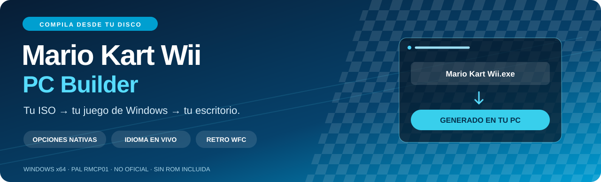
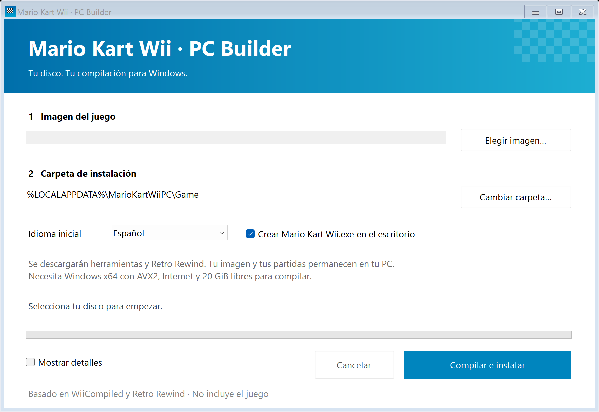
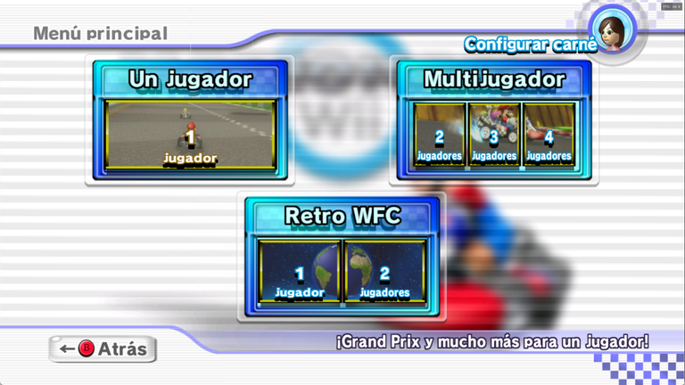
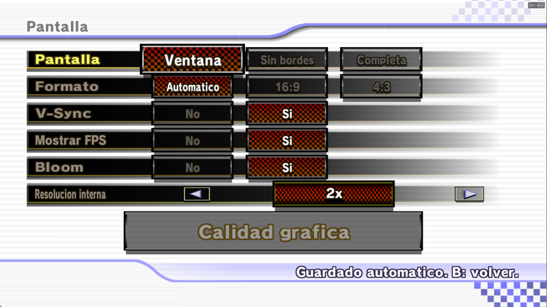
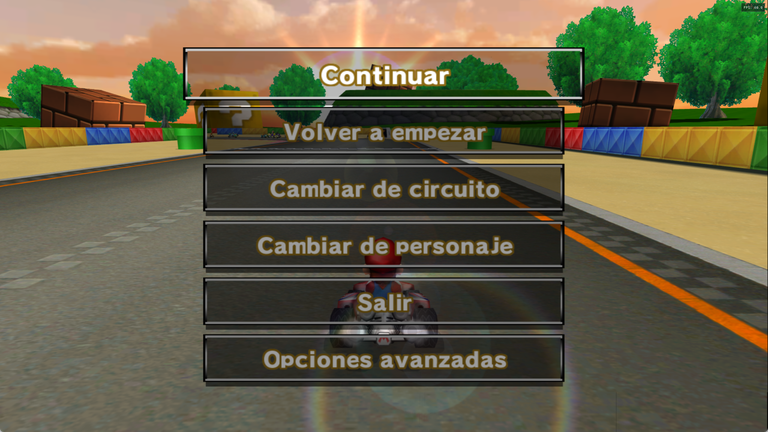
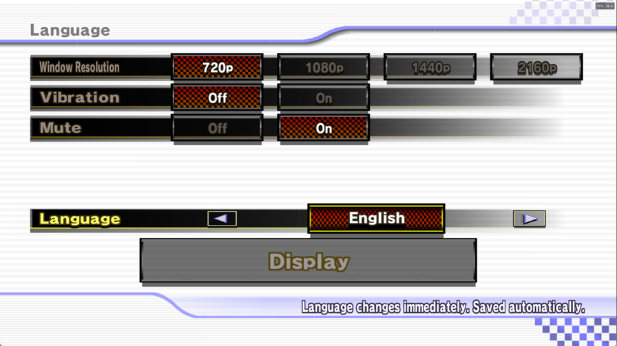
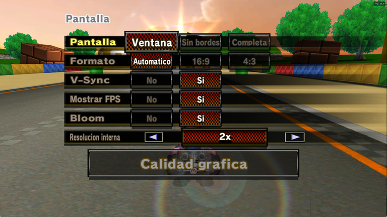
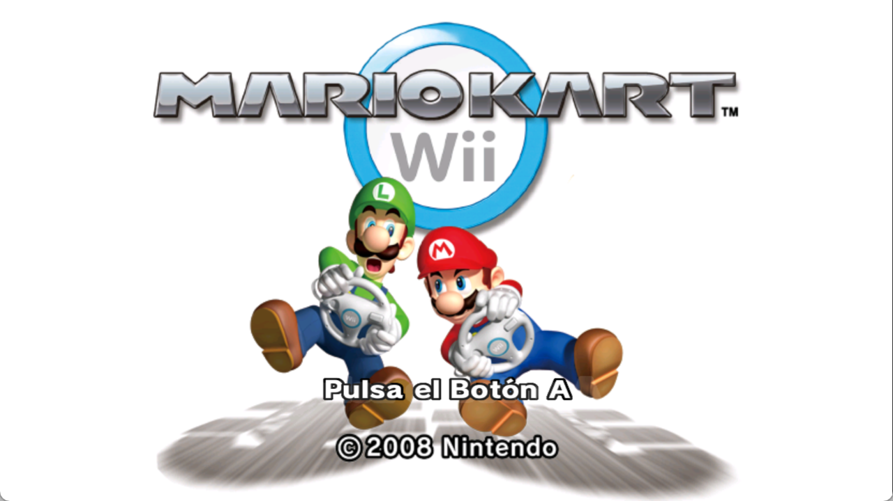

<div align="center">



[](https://github.com/MarcPique/mario-kart-wii-pc-builder/releases/latest)


[](LICENSE)

### Tu disco de Mario Kart Wii. Tu juego de Windows.

**Selecciona tu imagen PAL → compila en tu PC → abre Mario Kart Wii.exe desde el escritorio.**

**[⬇ Descargar el instalador para Windows](https://github.com/MarcPique/mario-kart-wii-pc-builder/releases/latest/download/MKWii-PC-Builder.exe)** · [Capturas](#capturas) · [Instalación](#instalación) · [Cambios](CHANGELOG.md)

</div>

Este builder genera una instalación nativa para Windows a partir de **tu propio disco PAL RMCP01**, con opciones de PC integradas en los menús del juego. El instalador público **no contiene la ROM, el juego recompilado, partidas ni claves de consola**.

## Lo que incluye

| 🏁 El juego | ⚙️ Opciones de PC | 🌍 Idiomas y online |
|---|---|---|
| Ventana **Mario Kart Wii** | **Opciones avanzadas** en Opciones y pausa | Español, English, Français, Deutsch e Italiano |
| Icono en EXE, ventana y barra de tareas | Presets, resolución, formato, V-Sync, AA y anisotropía | **Idioma inmediato**, sin reiniciar |
| Presentación original y preparación oculta | Controles, fuentes y animaciones nativos | Retro WFC en la misma sesión |
| EXE de arranque en el escritorio | Sin barra flotante ni necesidad de F10 | Salas al abrir y cada **40 segundos** |

El icono completo se obtiene **localmente del banner de tu disco**. La integración usa Retro Rewind **6.13.4**, incluido su contenido adicional y sus cambios de jugabilidad.

## Instalación

1. Descarga **[MKWii-PC-Builder.exe](https://github.com/MarcPique/mario-kart-wii-pc-builder/releases/latest/download/MKWii-PC-Builder.exe)** desde Releases.
2. Selecciona tu imagen **ISO, WBFS o RVZ** de Mario Kart Wii **PAL RMCP01**.
3. Elige la carpeta de instalación y pulsa **Compilar e instalar**.
4. Abre **Mario Kart Wii.exe** desde el escritorio o pulsa **Abrir el juego**.

No necesitas instalar Python, .NET, Visual Studio ni Dolphin. El instalador lleva su propio entorno y descarga las herramientas verificadas de WiiCompiled y Retro Rewind. La traducción y compilación se realizan en tu ordenador. No se envía la imagen del disco.

**Requisitos:** Windows 10/11 x64, CPU con AVX2, GPU compatible con D3D12, Internet y **20 GiB libres** para la compilación. Se recomiendan 16 GiB de RAM. Puede tardar varios minutos según el equipo y las descargas.

> El EXE del escritorio arranca la instalación elegida; los datos permanecen en esa carpeta. Si ya existe un archivo con ese nombre en el escritorio, se conserva y se utiliza otro nombre.

## Capturas

Capturas del juego durante las pruebas locales y de la interfaz del instalador. No se incluyen perfiles ni códigos de amigo.

<p align="center"></p>

| Menú principal | Opciones avanzadas |
|---|---|
|  |  |
| **Menú de pausa** | **Idioma en vivo** |
|  |  |
| **Ajustes desde la carrera** | **Presentación original** |
|  |  |

## Dentro del juego

En la selección de carné, entra en **Opciones → Opciones avanzadas**. En una carrera local, abre la pausa y elige **Opciones avanzadas**. El botón inferior cambia entre **Pantalla**, **Calidad gráfica** e **Idioma**.

Puedes cambiar resolución interna y de ventana, modo de pantalla, formato, V-Sync, FPS, bloom, MSAA 4x, anisotropía, nitidez, interpolación, vibración y silencio. Presets: **Original Wii, Bajo, Medio, Alto y Ultra**.

**El idioma cambia al instante**, incluidos los textos de menús ya abiertos y el nombre del botón. AA y anisotropía se guardan para el siguiente arranque; bloom se aplica al cargar una escena. Las demás opciones se aplican en vivo cuando lo permite el renderizador.

Entra en **Retro WFC** desde el menú del juego. Login, amigos y salas utilizan sus menús nativos en el mismo proceso. Se han probado el login y la creación y cierre de una sala de amigos. La disponibilidad y las normas dependen de [Retro WFC](https://rwfc.net/).

## Archivos y partidas

```text
Tu instalación/
├── Mario Kart Wii.exe       ← arranque portable
├── GameData/                ← juego generado desde tu disco
├── UserData/                ← ajustes, partidas y registros
└── .mkwii-builder/          ← herramientas y caché para recompilar
```

Para cambiar de PC, copia **Mario Kart Wii.exe + GameData + UserData** y abre el EXE de esa carpeta. El EXE del escritorio conserva la ruta original.

Partidas: `UserData/Saves/RetroWFC/RMCP`; datos de Wii: `UserData/NAND`; ajustes: `UserData/Config.toml`. Las actualizaciones creadas por el builder conservan `UserData` y guardan el contenido anterior como `GameData.previous`.

`.mkwii-builder` no es necesaria para jugar: contiene herramientas, descargas y fuentes generadas **solo en tu PC**. Para desinstalar, cierra el juego, conserva `UserData` si quieres tus partidas y elimina la instalación y su EXE del escritorio.

## Si algo falla

- **Imagen incompatible:** se admite PAL **RMCP01** sin modificar. Se verifican el ID y los hashes de `main.dol` y `StaticR.rel`.
- **Descarga interrumpida:** ejecuta de nuevo el instalador; conserva la caché y verifica SHA-256 antes de usarla.
- **Carpeta con acentos:** el builder crea un alias ASCII para el toolkit de Windows. Si el sistema no lo permite, elige una carpeta con letras A–Z y números.
- **Compilación fallida:** activa **Mostrar detalles** y consulta `.mkwii-builder/builder.log`. Revisa sus rutas personales antes de compartirlo.
- **Actualización interrumpida:** si falta `GameData` y existe `GameData.previous`, restaura el nombre `GameData` con el juego cerrado. Conserva o mueve `GameData.previous` antes de otra actualización. Nunca reemplaces `UserData` por un perfil de prueba.

El instalador no lleva firma Authenticode. El release incluye `SHA256SUMS.txt` para comprobar la descarga.

## Código y compilación del instalador

Se conservan las fuentes y el historial de **[WiiCompiled v0.9.3](https://github.com/patchzyy/Wiicompiled/releases/tag/v0.9.3)**, con los cambios del runtime y el builder. Los cambios de Aurora están en `pc-builder/patches/aurora-main`; el resto se obtiene del toolkit fijado. El README original está en [docs/UPSTREAM_README.md](docs/UPSTREAM_README.md).

Para compilar **el instalador**, sin una ROM:

```powershell
python -m unittest discover -s pc-builder/tests -v
python pc-builder/build_installer.py
```

Necesitas Python 3 y .NET SDK 10. Salida: `pc-builder/dist/MKWii-PC-Builder.exe`. Las versiones y hashes están en [pins.json](pc-builder/worker/pins.json). El payload se construye desde una lista de fuentes permitidas y no toma archivos de una instalación de juego.

Interfaz de línea de comandos:

```powershell
.\MKWii-PC-Builder.exe --iso "D:\Mi disco.iso" --install-dir "D:\Mario Kart Wii PC"
```

`--self-test` comprueba el entorno integrado. También existen `--no-desktop`, `--desktop-dir`, `--cache-dir`, `--language es` y `--jobs 4`.

## Créditos

WiiCompiled / **patchzyy**, Retro Rewind / Retro WFC, MelgMKW / Pulsar, Aurora y los autores de las bibliotecas utilizadas. Desarrollo asistido por **Codex (OpenAI, GPT-6)**, con compilación y pruebas locales. [Avisos y licencias](pc-builder/THIRD-PARTY-NOTICES.md).

**Proyecto no oficial. Mario Kart Wii y sus marcas pertenecen a Nintendo.** El código de este fork se distribuye bajo **GPL-3.0**; las bibliotecas conservan sus licencias. Las capturas documentan el resultado y no son paquetes de recursos del juego.
