<div align="center">

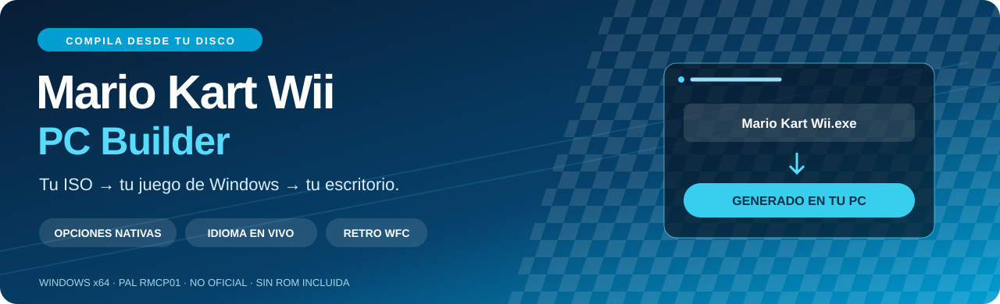

[](https://github.com/MarcPique/mario-kart-wii-pc-builder/releases/download/v1.2.0/MKWii-PC-Builder.exe)


[](#online-habilitado)
[](LICENSE)

### Tu disco de Mario Kart Wii. Tu juego de Windows.

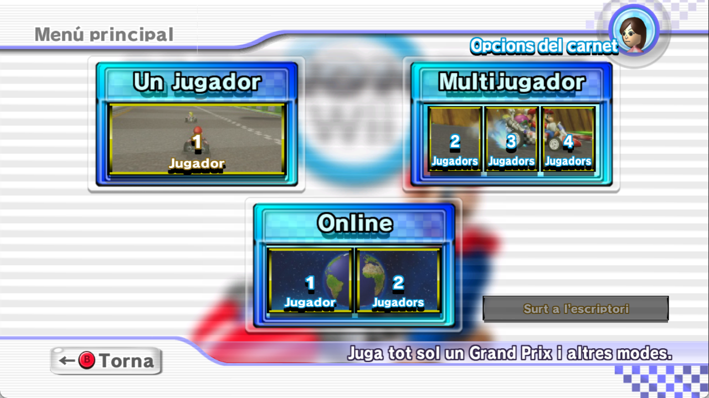

**Selecciona tu imagen PAL → compila en tu PC → abre Mario Kart Wii.exe desde el escritorio.**

**[⬇ Descargar para Windows · 1.2.0](https://github.com/MarcPique/mario-kart-wii-pc-builder/releases/download/v1.2.0/MKWii-PC-Builder.exe)**

[Capturas](#capturas) · [Instalación](#instalación) · [Idiomas](#15-idiomas-sin-reiniciar) · [Online](#online-habilitado) · [Texturas](#paquetes-de-texturas-de-dolphin) · [Cambios](CHANGELOG.md)

</div>

Este builder genera una instalación nativa para Windows a partir de **tu propio disco PAL RMCP01**, con opciones de PC integradas en los menús del juego. El instalador público **no contiene la ROM, el juego recompilado, partidas ni claves de consola**.

**✅ Online habilitado para uno o dos jugadores por PC:** login, amigos y salas integrados en el propio juego, sin cerrar ni cambiar de ejecutable. Las salas se consultan al iniciar y se actualizan automáticamente cada **40 segundos**.

> **Versión 1.2.0:** Online para uno o dos jugadores, distribución Nintendo, My Stuff y cambio de partida desde el juego. [Notas y SHA-256](https://github.com/MarcPique/mario-kart-wii-pc-builder/releases/tag/v1.2.0).

## Lo que incluye

| Función | Incluido en 1.2.0 |
|---|---|
| 🏁 Presentación original | Ventana **Mario Kart Wii**, icono en EXE, ventana y barra de tareas; preparación inicial en segundo plano |
| ⚙️ Opciones avanzadas | Integradas en **Opciones y pausa**, con controles, fuentes y animaciones nativos |
| 🖥️ Pantalla y gráficos | Presets, resolución interna y de ventana, **16 formatos**, V-Sync, MSAA y anisotropía |
| 🌍 Idiomas | **15 idiomas**, incluidos catalán, gallego, euskera y andalûh; cambio inmediato |
| 🎮 Mandos | Hasta **4 jugadores locales**, asignación automática J1–J4 y reasignación desde el juego |
| 🌐 Online habilitado | **Online**, uno o dos jugadores por PC, login, amigos y selector de salas; consulta inicial y refresco cada **40 segundos** |
| 🏎️ Retro Rewind | Circuitos adicionales y variantes de personajes utilizables también en carreras locales |
| 🎨 Texturas de Dolphin | **PNG, DDS, ZIP y 7z**; activar, desactivar y recargar sin reiniciar; originales donde falte una textura |
| 🚪 Salir al escritorio | Botón en el menú principal con confirmación original y **Cancelar** seleccionado inicialmente |
| 🎵 My Stuff y partidas | Cinco modos originales, preparación en segundo plano y cambio confirmado de banco sin reiniciar el EXE |
| 📦 Instalación | EXE de arranque en el escritorio; actualizaciones que conservan ajustes y partidas |

El icono completo se obtiene **localmente del banner de tu disco**. La integración usa Retro Rewind **6.13.4**, incluido su contenido adicional y sus cambios de jugabilidad.

### 15 idiomas sin reiniciar

**Español · English · Français · Deutsch · Italiano · Nederlands · Čeština · Suomi · Русский · Türkçe · Español LA · Català · Galego · Euskara · Andalûh**

El cambio actualiza los textos del juego, Retro Rewind y las opciones de PC **al instante**, incluidos los menús ya abiertos. Solo utiliza las fuentes existentes. Las voces y el texto integrado en imágenes no cambian. Los avisos enviados por el servidor de Retro WFC se muestran en su idioma original y pueden estar en inglés.

**Idiomas revisados en 1.2.0:** catálogo de **92 textos de PC por idioma (1.380 entradas)** y **1.543 fragmentos de juego por idioma** en catalán, gallego y euskera. La revisión final corrige además acrobacias, invitaciones, plurales, instrucciones y nombres de circuitos. Los tres idiomas pasan a estado **revisado**, sin asteriscos ni aviso beta en el juego o instalador. La generación de un paquete de publicación exige cobertura completa de la revisión y validación de fuentes, botones y variables.

Catalán, gallego y euskera tienen **origen automático con revisión contextual posterior**, documentado en el paquete. Los otros idiomas conservan los textos de Retro Rewind con el catálogo de PC revisado. **Andalûh es una transcripción EPA del español.** Japonés y coreano no se ofrecen por falta de caracteres en las fuentes existentes. Son traducciones no oficiales, sin certificación por hablantes nativos; pueden recibir correcciones. [Procedencia, alcance y comprobaciones](docs/LOCALIZATION.md).

### Pantallas y calidad gráfica

Presets **Original Wii, Bajo, Medio, Alto, Ultra y Personalizado**. Modos ventana, sin bordes y pantalla completa; resolución interna y de ventana, V-Sync, contador FPS, bloom, MSAA 4x, anisotropía, nitidez e interpolación 60/120. También hay opciones de vibración y silencio.

**16 formatos:** Automático, 4:3, 5:4, 3:2, 16:10, 16:9, 1.85:1, 2:1, 21:9, 43:18 —3440×1440—, 64:27 —2560×1080—, 32:10, 32:9, 48:9, 1:1 y 9:16.

El selector completo está en **Opciones avanzadas → Pantalla → Formato**, en la fila inferior. Los tres botones de **Formato rápido** son accesos directos. Automático sigue la ventana; los formatos fijos mantienen las proporciones con bandas cuando corresponde. La cámara se adapta al formato. La resolución interna tiene su propia página.

Formato, MSAA y anisotropía se pueden cambiar sin reiniciar. Bloom se aplica al cargar una escena. Se han recorrido los 16 formatos y probado una carrera a 32:9; las pruebas se hicieron en una GPU y en ventanas de prueba, sin certificar todos los monitores o tarjetas gráficas.

### Mandos y multijugador local

Al abrir el juego o conectar/desconectar dispositivos, los mandos ocupan automáticamente **J1, J2, J3 y J4**, antes que el teclado, conservando su orden relativo y rellenando puestos libres. **Sin mando, el teclado controla J1.** En **Opciones avanzadas → Mandos**, selecciona el dispositivo y pulsa **Asignar** en el jugador deseado; **Vaciar** libera su puesto. La reasignación manual se conserva hasta el siguiente cambio de dispositivos o arranque.

El selector reconoce familias **DualSense, DualShock, Xbox, Switch Pro, Joy-Con y mandos Switch genéricos**. El panel inferior muestra el **nombre completo del modelo**, y cada fila permite consultar su asignación. La identidad del dispositivo se mantiene al desconectar y volver a conectar. Se ha verificado un **DualSense Edge por Bluetooth**, además de pruebas con mandos virtuales, cuatro jugadores y conexión/desconexión en vivo. Otros modelos y cuatro mandos físicos simultáneos necesitan pruebas en esos dispositivos.

**Distribución Nintendo predeterminada:** A a la derecha, B abajo, X arriba e Y a la izquierda. En **DualSense/DualShock, círculo acepta y acelera; X vuelve y frena; triángulo es X y cuadrado es Y**. Se corrigen también los antiguos valores predeterminados guardados. Las asignaciones personalizadas explícitas se conservan.

### Circuitos y personajes de Retro Rewind

Incluye el contenido de **Retro Rewind 6.13.4**, con circuitos adicionales y variantes de personajes. Para mostrar todos los circuitos: **Un jugador → Ajustes → Carrera → Selección de pistas → Todas las pistas**. Esta opción ya se activa al crear ajustes nuevos; los ajustes existentes se conservan.

Los **personajes personalizados también se usan en las carreras locales**: selecciona un personaje y pulsa **L/R** para elegir su variante antes de confirmar —**L1/R1** en DualSense con la configuración predeterminada—. Se ha verificado **Mario (Fire) en Grand Prix**, además de la pantalla de selección. Se utilizan las variantes incluidas en el pack instalado.

### Paquetes de texturas de Dolphin

1. Copia tus **PNG/DDS sueltos o archivos ZIP/7z** en `UserData/Load/Textures/RMCP01/`. También se admite `RMC/` para paquetes sin región.
2. Conserva los nombres de Dolphin **`tex1_...`** y las carpetas del paquete; pueden estar anidadas.
3. Abre **Opciones avanzadas → Paquetes de texturas**, activa **Texturas** y pulsa **Recargar**. El botón **Carpeta → Abrir** abre la ubicación correspondiente.

Los ZIP y 7z se importan **en segundo plano al arrancar o recargar**, sin reiniciar el juego ni instalar 7-Zip por separado. Se admite la estructura de paquetes de recursos de Dolphin. Los PNG/DDS sueltos tienen prioridad sobre los comprimidos. El menú muestra el estado y el número de texturas; las importaciones completas se guardan en caché.

**Si falta una textura, está dañada o no es compatible, se usa la original en esa parte.** Puedes desactivar o retirar el paquete y recargar para volver a los originales. Los archivos del juego no se sobrescriben y no se incluye ni descarga ningún pack. RAR debe extraerse antes; los archivos cifrados no se importan. [Carpetas, compatibilidad y límites](docs/TEXTURE-PACKS.md).

### Presentación y salida

El juego conserva su presentación y menús originales. La preparación inicial se realiza en segundo plano; no aparece la pantalla de WiiCompiled. El nombre de la ventana es **Mario Kart Wii** y el icono completo se obtiene localmente del banner del disco para el EXE, la ventana y la barra de tareas.

**Salir al escritorio** aparece en el menú principal con la confirmación nativa: **Cancelar** es la opción inicial, **B** vuelve al juego y confirmar **Salir** cierra la aplicación.

## Instalación

1. Descarga **[MKWii-PC-Builder.exe · 1.2.0](https://github.com/MarcPique/mario-kart-wii-pc-builder/releases/download/v1.2.0/MKWii-PC-Builder.exe)** desde Releases.
2. Selecciona tu imagen **ISO, WBFS o RVZ** de Mario Kart Wii **PAL RMCP01**.
3. Elige la carpeta de instalación y pulsa **Compilar e instalar**.
4. Abre **Mario Kart Wii.exe** desde el escritorio o pulsa **Abrir el juego**.

No necesitas instalar Python, .NET, Visual Studio ni Dolphin. El instalador lleva su propio entorno y descarga las herramientas verificadas de WiiCompiled y Retro Rewind. La traducción y compilación se realizan en tu ordenador. No se envía la imagen del disco.

**Requisitos:** Windows 10/11 x64, CPU con AVX2, GPU compatible con D3D12, Internet y **20 GiB libres** para la compilación. Se recomiendan 16 GiB de RAM. Puede tardar varios minutos según el equipo y las descargas.

> El EXE del escritorio arranca la instalación elegida; los datos permanecen en esa carpeta. Si ya existe un archivo con ese nombre en el escritorio, se conserva y se utiliza otro nombre.

## Capturas

Capturas reales de las pruebas locales: instalador, menús nativos y carreras. Se han seleccionado pantallas sin códigos de amigo ni datos personales.

<p align="center">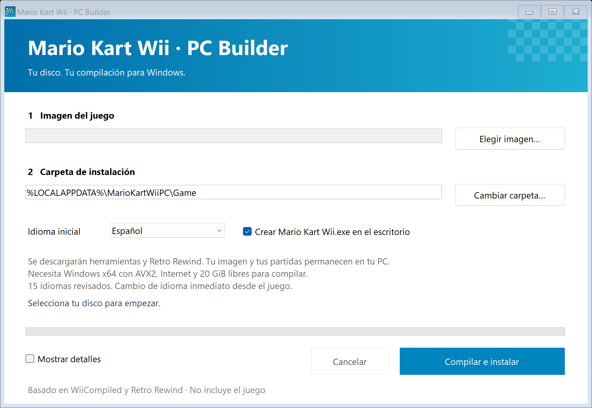</p>

| Menú original, Retro WFC y salida al escritorio | Opciones de pantalla y selector de formato |
|---|---|
| 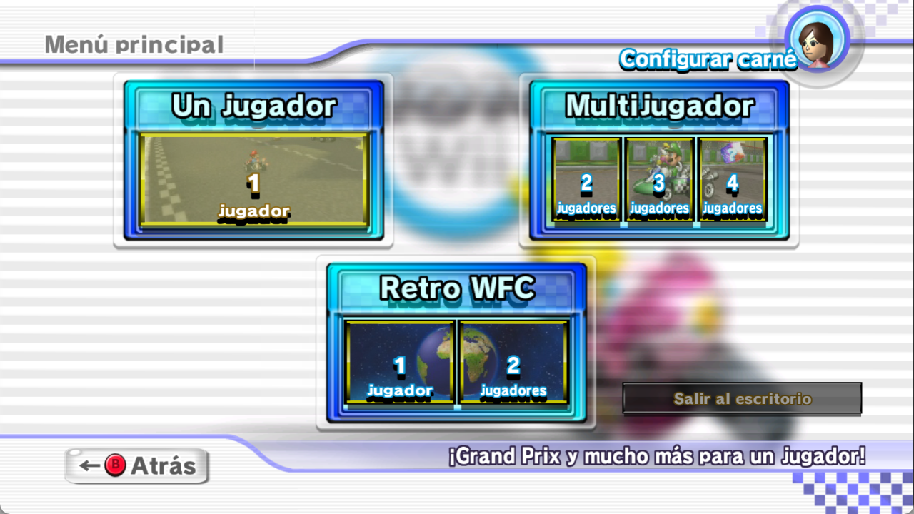 | 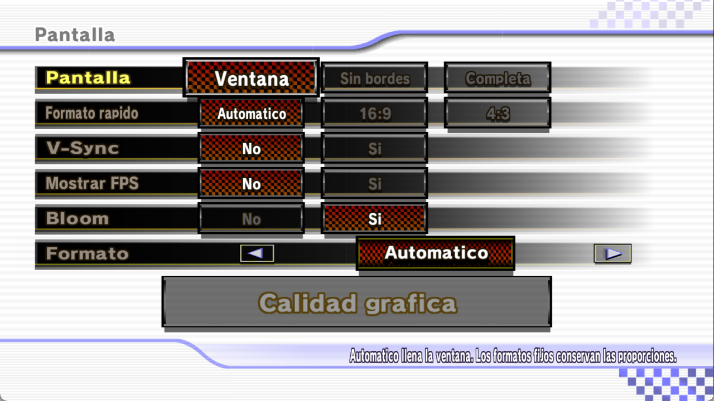 |
| **Opciones avanzadas en la pausa** | **Ajustes durante una carrera pausada** |
| 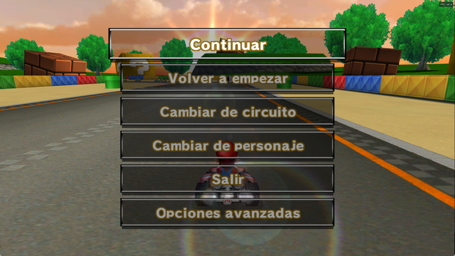 | 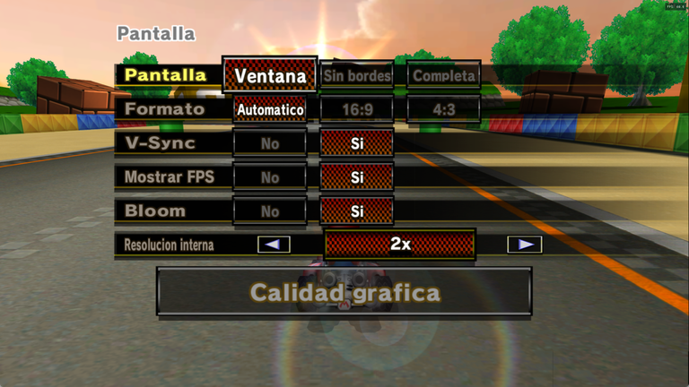 |
| **Català · idioma revisado en vivo** | **Galego · idioma revisado en vivo** |
| 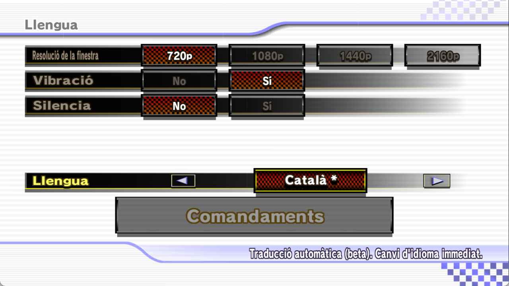 | 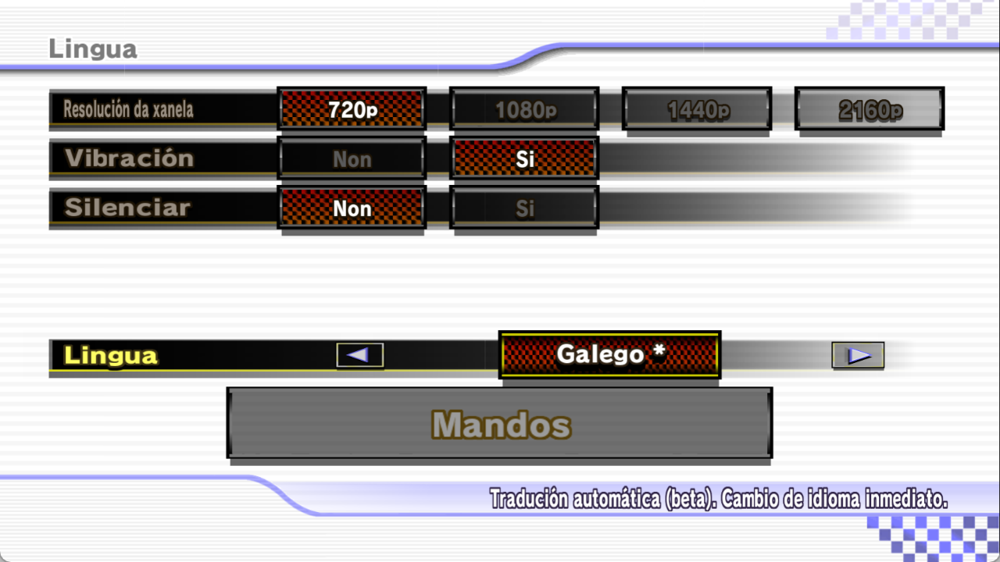 |
| **Euskara · fuentes existentes** | **Andalûh · transcripción EPA** |
| 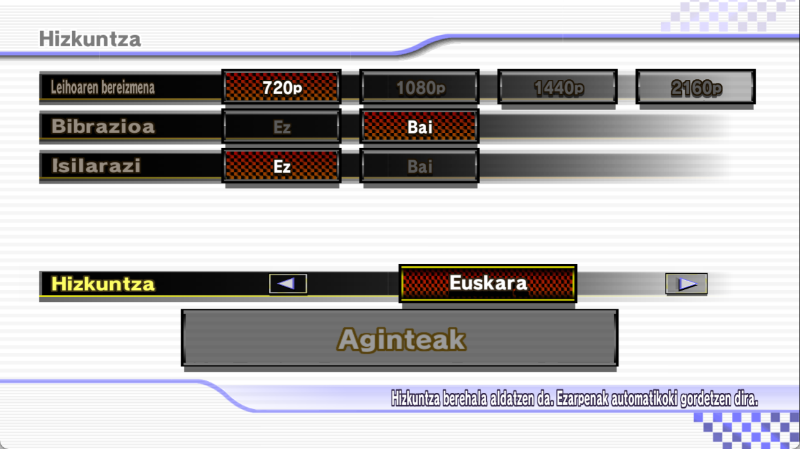 |  |
| **Terminología de juego revisada en catalán** | **Cilindradas y descripción de Grand Prix** |
| 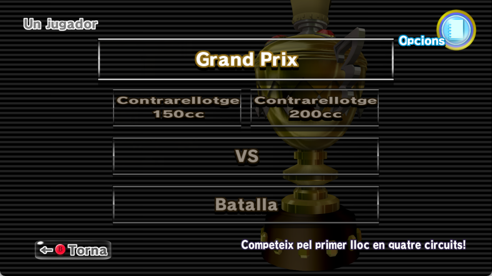 | 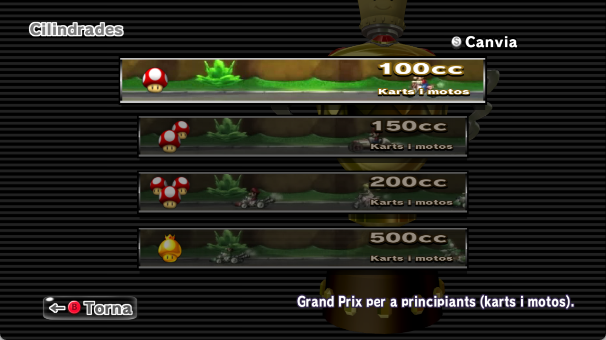 |
| **Asignación J1–J4 y nombre completo del mando** | **Gestión de texturas desde el juego** |
| 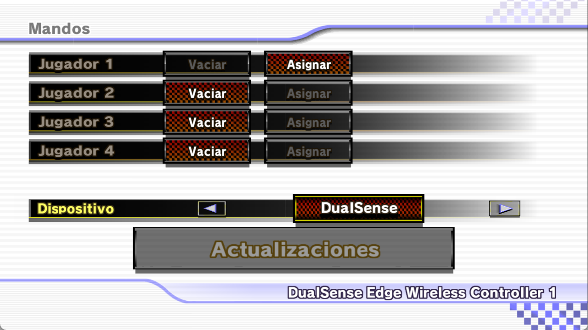 | 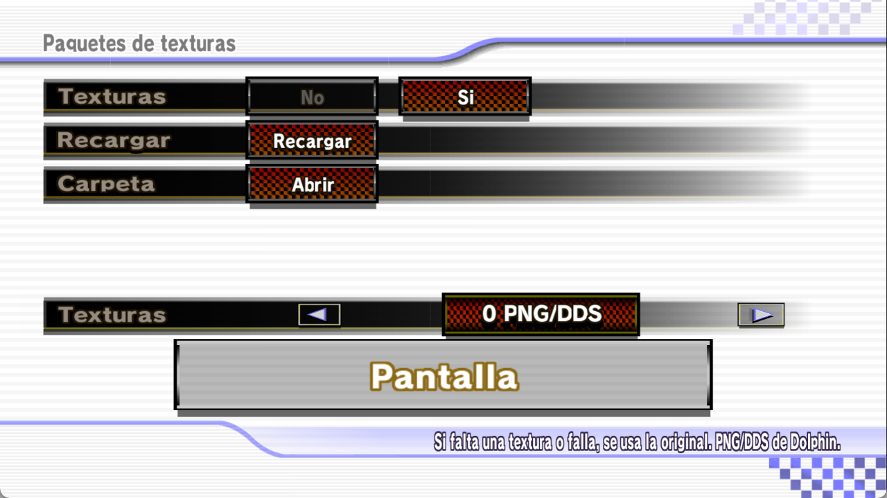 |
| **Personajes personalizados en la selección** | **Los mismos personajes en carreras locales** |
| 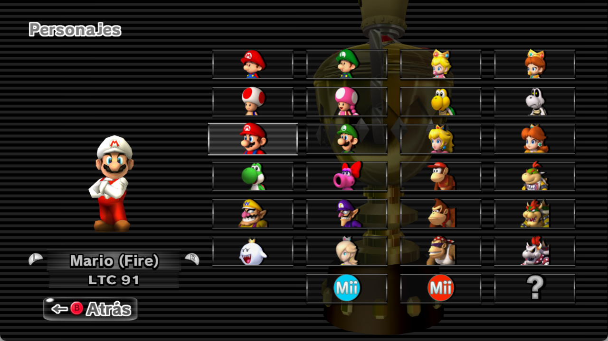 | 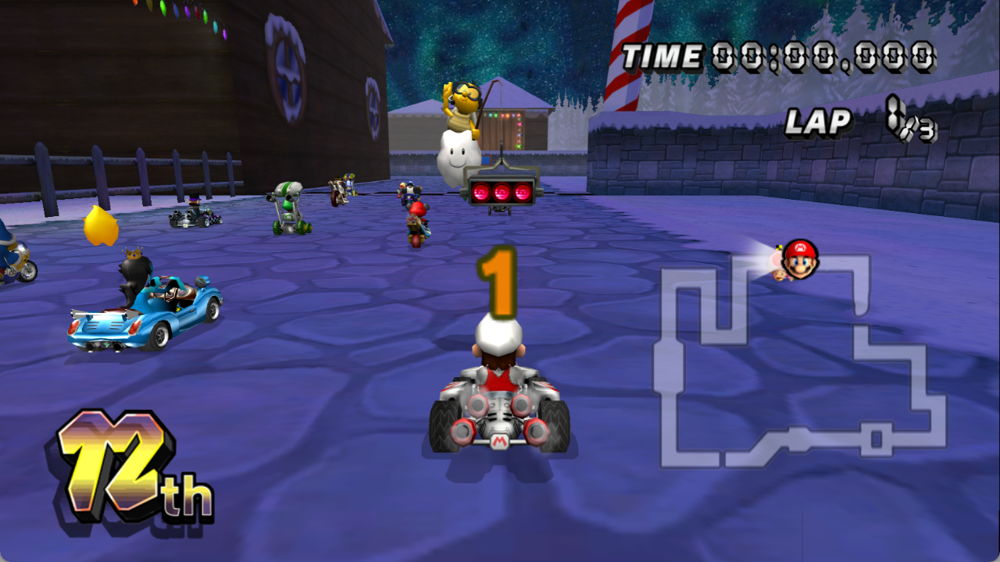 |
| **Salir con confirmación y Cancelar inicial** | **Formato 21:9 seleccionado en vivo** |
| 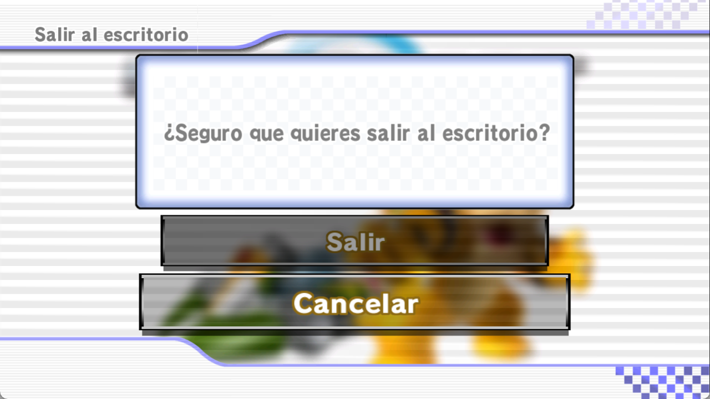 | 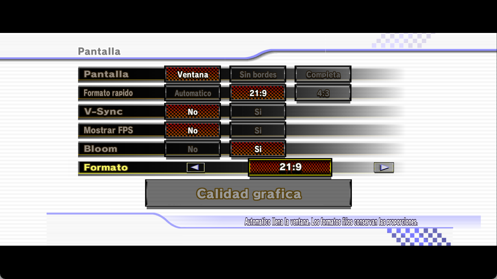 |

**Carrera a 32:9:** Mario (Fire) en Grand Prix, en una ventana de prueba de 1920×540. La captura muestra el formato de la cámara; no utiliza un paquete de texturas HD.

<p align="center">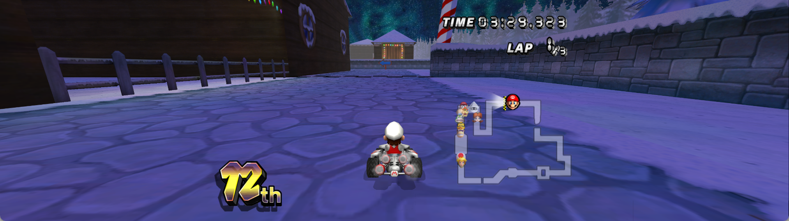</p>

## Dentro del juego

En la selección de carné, entra en **Opciones → Opciones avanzadas**. Durante una carrera local, abre la pausa y elige **Opciones avanzadas**. No necesitas F10 ni una barra flotante durante el juego.

El botón grande inferior recorre **Pantalla → Calidad gráfica → Idioma → Mandos → Actualizaciones → Resolución interna → Paquetes de texturas**. El selector de los **16 formatos está en la primera página, Pantalla**, en la fila inferior **Formato**.

## Online habilitado

El modo **Online** está habilitado con la integración de Retro Rewind 6.13.4 y admite **uno o dos jugadores por PC**. Entra en **Online** desde el menú original: login, amigos y salas utilizan sus menús nativos **en el mismo proceso, sin cerrar el juego ni abrir otro launcher**. La disponibilidad y las normas dependen de [Retro WFC](https://rwfc.net/).

Las salas públicas se consultan **al iniciar el juego y cada 40 segundos**. El contador muestra su estado y el botón **Salas** permite elegir una sala compatible, con paginación y avisos si deja de estar disponible. También están disponibles el emparejamiento mundial y las salas de amigos.

Se han verificado el login, la creación y cierre de una sala de amigos y la entrada a salas **Retro y CT**. Otros modos y cambios de anfitrión necesitan más pruebas. **Hasta cuatro jugadores locales sin conexión; hasta dos jugadores locales por PC en Retro WFC.**

## Límites actuales

- **Cuatro jugadores online desde un único PC no están implementados**; el protocolo actual admite dos por conexión.
- La ruta específica para salas **CT 200cc** no está disponible.
- No hay selector **My Stuff** ni cambio de partida separada durante la sesión. La preparación experimental de My Stuff está desactivada en los arranques normales.
- **Actualizaciones** comprueba versiones y avisa; no reemplaza el código del juego mientras está en ejecución. No están integradas todas las funciones del launcher externo de Retro Rewind.
- La revisión de idiomas no certifica todas las traducciones heredadas ni cada disposición de texto. Las pruebas de mandos, GPU, pantallas y paquetes no certifican todas las combinaciones de hardware y contenido.

## Archivos y partidas

```text
Tu instalación/
├── Mario Kart Wii.exe       ← arranque portable
├── GameData/                ← juego generado desde tu disco
├── UserData/                ← ajustes, partidas y registros
└── .mkwii-builder/          ← herramientas y caché para recompilar
```

Para cambiar de PC, copia **Mario Kart Wii.exe + GameData + UserData** y abre el EXE de esa carpeta. El EXE del escritorio conserva la ruta original.

Partidas: `UserData/Saves/RetroWFC/RMCP`; datos de Wii: `UserData/NAND`; ajustes: `UserData/Config.toml`. Las actualizaciones creadas por el builder conservan `UserData` y guardan el contenido anterior como `GameData.previous`.

`.mkwii-builder` no es necesaria para jugar: contiene herramientas, descargas y fuentes generadas **solo en tu PC**. Para desinstalar, cierra el juego, conserva `UserData` si quieres tus partidas y elimina la instalación y su EXE del escritorio.

## Si algo falla

- **Imagen incompatible:** se admite PAL **RMCP01** sin modificar. Se verifican el ID y los hashes de `main.dol` y `StaticR.rel`.
- **Descarga interrumpida:** ejecuta de nuevo el instalador; conserva la caché y verifica SHA-256 antes de usarla.
- **Carpeta con acentos:** el builder crea un alias ASCII para el toolkit de Windows. Si el sistema no lo permite, elige una carpeta con letras A–Z y números.
- **Compilación fallida:** activa **Mostrar detalles** y consulta `.mkwii-builder/builder.log`. Revisa sus rutas personales antes de compartirlo.
- **Actualización interrumpida:** si falta `GameData` y existe `GameData.previous`, restaura el nombre `GameData` con el juego cerrado. Conserva o mueve `GameData.previous` antes de otra actualización. Nunca reemplaces `UserData` por un perfil de prueba.

El instalador no lleva firma Authenticode. El release incluye `SHA256SUMS.txt` para comprobar la descarga.

## Código y compilación del instalador

Se conservan las fuentes y el historial de **[WiiCompiled v0.9.3](https://github.com/patchzyy/Wiicompiled/releases/tag/v0.9.3)**, con los cambios del runtime y el builder. Los cambios de Aurora están en `pc-builder/patches/aurora-main`; el resto se obtiene del toolkit fijado. El README original está en [docs/UPSTREAM_README.md](docs/UPSTREAM_README.md).

Para compilar **el instalador**, sin una ROM:

```powershell
python -m unittest discover -s pc-builder/tests -v
python pc-builder/build_installer.py
```

Necesitas Python 3 y .NET SDK 10. Salida: `pc-builder/dist/MKWii-PC-Builder.exe`. Las versiones y hashes están en [pins.json](pc-builder/worker/pins.json). El payload se construye desde una lista de fuentes permitidas y no toma archivos de una instalación de juego.

Interfaz de línea de comandos:

```powershell
.\MKWii-PC-Builder.exe --iso "D:\Mi disco.iso" --install-dir "D:\Mario Kart Wii PC"
```

`--self-test` comprueba el entorno integrado. También existen `--no-desktop`, `--desktop-dir`, `--cache-dir`, `--language es` y `--jobs 4`.

## Créditos

WiiCompiled / **patchzyy**, Retro Rewind / Retro WFC, MelgMKW / Pulsar, Aurora y los autores de las bibliotecas utilizadas. Desarrollo asistido por **Codex (OpenAI, GPT-6)**, con compilación y pruebas locales. [Avisos y licencias](pc-builder/THIRD-PARTY-NOTICES.md).

**Proyecto no oficial. Mario Kart Wii y sus marcas pertenecen a Nintendo.** El código de este fork se distribuye bajo **GPL-3.0**; las bibliotecas conservan sus licencias. Las capturas documentan el resultado y no son paquetes de recursos del juego.
