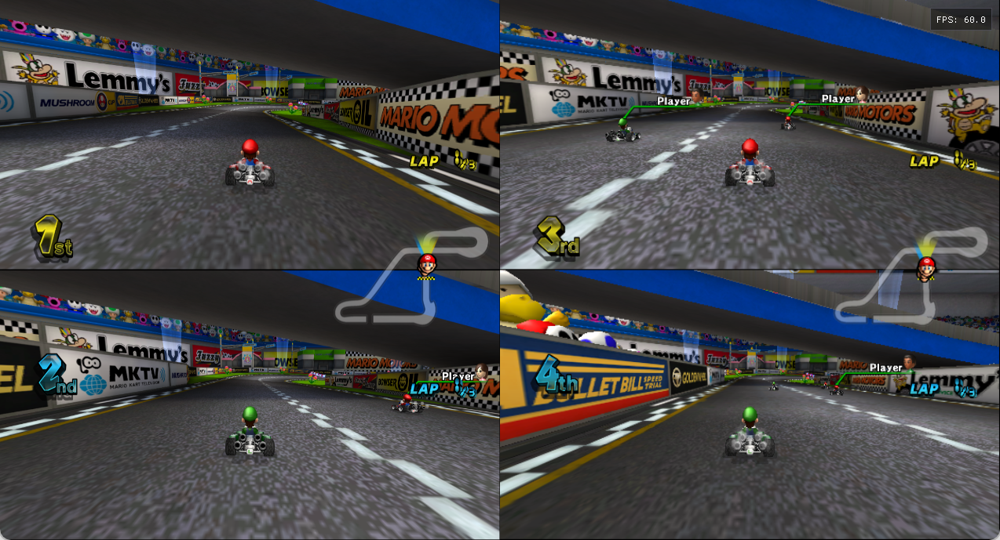

# Retro Rewind integration work

This document tracks the development branch. The public stable release remains
1.1.0; the work below is not yet included in its installer or desktop runtime.

The reference launcher is [Retro Rewind Team rr-launcher](https://github.com/Retro-Rewind-Team/rr-launcher/tree/d7bde0b7dd933e4c5cfc7b4c237c49b97e135baf),
especially `source/settings.c`. The compatible installed content remains Retro
Rewind 6.13.4 and the user's PAL RMCP01 disc.

| Area | Development state | Verification and remaining work |
|---|---|---|
| My Stuff | Native page with the five original choices, Apply and Folder; settings persist. Portable user content takes priority over the legacy SD-style folders. Preparation runs in the background and publishes on the game thread. Leaving these options cancels it. | Real DVD tests passed mode changes, stable entry IDs, hidden inactive files, retained reads after source replacement/deletion, late-added background music and cancelled publication. The native Apply button also passed. Arbitrary new paths that would change existing entry IDs are rejected; further general hot-reload work and final installer tests remain. |
| Separate savegame | Native page and confirmation, initially Cancel. Switches future save opens and reloads the licenses, returning to the title in the same process. | Real native-menu roundtrip passed. Both banks stayed byte-identical. An invalid target was rejected and the original bank restored, including an exact check of the loaded save core in guest memory. Final installer/update testing remains. |
| Session isolation | Named sessions keep their own configuration, NAND, saves, cache, textures, mappings and logs while sharing immutable game content. Invalid names fail closed; a follower without a separate profile is rejected before resolving mutable paths. | Pure contracts and two concurrent native processes passed. Each process used a distinct mutable-data directory. |
| Four local players online | Development uses two compatible clients with separate profiles, following the user's preference for public Retro WFC. An input-only local channel routes the main session's J3/J4 to the second client's J1/J2; only the main session reads physical controls. | Two distinct profiles joined an own friends room on the public server and raced with two local players each. Four persistent SDL virtual controllers individually accelerated their corresponding karts, with progress received by both clients. The shared-window prototype displayed all four race views; a 35.6-second active observation measured 60.0 simulation frames/s in each client without disconnection. Loading-pause and short-tap fixes passed. Earlier idle observations ended with error 83337; its cause and longer sessions still need checking. Integration into the product launcher remains pending. This is not available in the stable installer. |
| CT 200cc room routing | Pending compatibility investigation. | The current native room route table has no verified path for `vs_22`. Do not route it through a different mode or advertise it as available. |
| Launcher updates | Stable release checks official version information. | Download, staging, repair/application and coordination with active sessions still need implementation and tests. Replacing running native code is not implemented. |
| Hardware coverage | DualSense Edge Bluetooth was verified by the user in 1.1.0. Existing virtual-controller and aspect-ratio tests remain relevant. | More physical models, simultaneous controllers, the integrated GPU, and combined online-session performance still need validation. |

My Stuff files intended to survive updates belong under
`UserData/MyStuff/CTGP` or `UserData/MyStuff/RetroRewind`. The legacy directories
inside the virtual SD/game-data tree remain readable. Save banks are
`UserData/Saves/RetroWFC/RMCP` and `UserData/Saves/RetroWFC2/RMCP`.

Applied My Stuff files are copied to immutable SHA-256 versions under each
profile's `Cache/MyStuff`. Replacing or deleting a source file does not invalidate
an already open DVD handle. Reads retain their published catalogue while in
progress; cancellation does not change the active catalogue or setting. The
cache is not pruned while old handles may still refer to its contents. The five
standard background-music paths are reserved at boot, including absent files.

The local input channel is a development component; the stable launcher does not
enable it. Its coordinator must supply a fresh 32-character hexadecimal group
name and a host/follower role. The follower uses the main process's completed
input mapping, avoiding SDL device-order differences across processes. It does
not poll physical input or apply a second set of keyboard bindings. Short button
presses are retained for at most 250 ms and consumed once, including when the
consumer polls after release. Old inputs are neutralized during loading while
the owning Windows process is alive. Closing the channel or losing the process
disconnects the controls. An abandoned shared-memory lock invalidates the
channel. Host gamepads work in the background while both sessions run.

Live input lifecycle APIs can enable, disable and re-enable a group without
restarting the primary process. Two-process tests and a native SDL test passed
the sequence of four ordinary local ports, two coordinated host ports, then four
local ports again, twice in the same process. Ending a group clears pending
presses and rumble state. Connecting these APIs to the product launcher and its
native menu remains part of the pending integration.

This capture is from an own friends room on the public Retro WFC service. All
four participants belong to the local test. It demonstrates the development
prototype, not a feature already exposed by the stable launcher. The input test
uses persistent SDL virtual gamepads; it does not certify four physical models.
The primary process stayed open throughout the native menu and race transitions.

Save switching is available from Options. The pause menu does not permit a live
save change during a race. Busy saves or an invalid target retain the current
bank. Returning to the title is an in-process menu transition, not an EXE restart.

The 92 PC labels are reviewed in all fifteen languages. Andaluh labels use the
same protected EPA transcription as the existing catalog. The original/Retro
Rewind message-bank hash remains unchanged in this development milestone.

Only source, project-owned labels and the source-checked BPS patch are suitable
for publication. Disc files, generated native game binaries, raw message banks,
save/profile fixtures and private test captures remain local.
